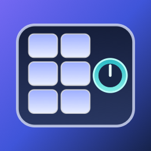

# Keyflow



A native macOS menu bar app for the supported macropad. Its compact, arrowless control panel floats
from the menu bar item and is built with SwiftUI in a borderless `NSPanel` using AppKit's semantic
popover material. Keyflow has no main window; open its panel from the menu bar and use the Quit
control there to exit.

## Implemented features

- **Macropad status:** Detects USB connection and disconnection and shows the current state in the
  menu bar panel.
- **Profile switching:** Select a profile manually, or let Keyflow choose one from the frontmost
  app and (in Google Chrome) the active tab's website.
- **Key mappings:** Applies profile mappings to the pad, including key combinations and knob actions.
- **Bundled profiles:** Includes Claude Code and X Social layouts. Profiles and matching rules are
  maintained as YAML files in pull requests.
- **Native menu bar UI:** Provides a compact floating popover and a custom macropad icon for the app.

The app recognizes USB vendor `0x1189` and product `0x8890`. IOKit attach/detach notifications
update status immediately; a 30-second USB scan reconciles missed events. A compact
Connected/Not connected text in the panel header and menu bar item shows the current state.
Keyflow applies selected profile mappings through the pad's raw USB configuration endpoint using
the bundled, dynamically loaded libusb library. The pad does not provide readback, so Keyflow
records its last fully successful write and performs a full apply whenever that state becomes
unknown. See [the protocol notes](docs/macropad-protocol.md) and [the bundled library notice](Vendor/NOTICE.md).

The bundled profile catalog is in `Resources/Profiles/`. It currently defines Claude Code and X
Social layouts and their app/site rules. The panel lists profiles without exposing current focus.
Focus is still monitored internally for automatic matching. App rules select a matching profile
after the catalog's settle delay. When Google Chrome is
frontmost, Keyflow reads its active tab URL and matches configured site hosts, including subdomains.
The first lookup may prompt for macOS Automation permission. Window-title rules and other browsers
are not supported yet. Manual selection lasts until focus matches an app rule or configured
default. The **Quit** action exits the app; closing the panel leaves it running in the menu bar.

Profile contributions should update the catalog and add or edit a layout YAML file in a pull
request. Validate a catalog before submitting it:

```sh
build/Keyflow\ Status.app/Contents/MacOS/KeyflowStatus \
  --validate-catalog Resources/Profiles/catalog.yaml
```

The schema version is `1`. Each profile has an `id`, display `name`, and relative layout path.
Rules match an `app`, window `title`, or browser `site`, and refer to a profile ID. An optional
`default` chooses the fallback profile; `settle` defaults to 0.5 seconds. Layout actions use the
existing macropad action syntax, and the loader rejects unknown fields, slots, layers, or actions.

## Build

Requires macOS and Xcode command line tools.

```sh
./build.sh
open "build/Keyflow Status.app"
```

The compiled executable is `build/Keyflow Status.app/Contents/MacOS/KeyflowStatus`.
Pass `--preview` when launching the app bundle to show the floating panel for visual inspection.
